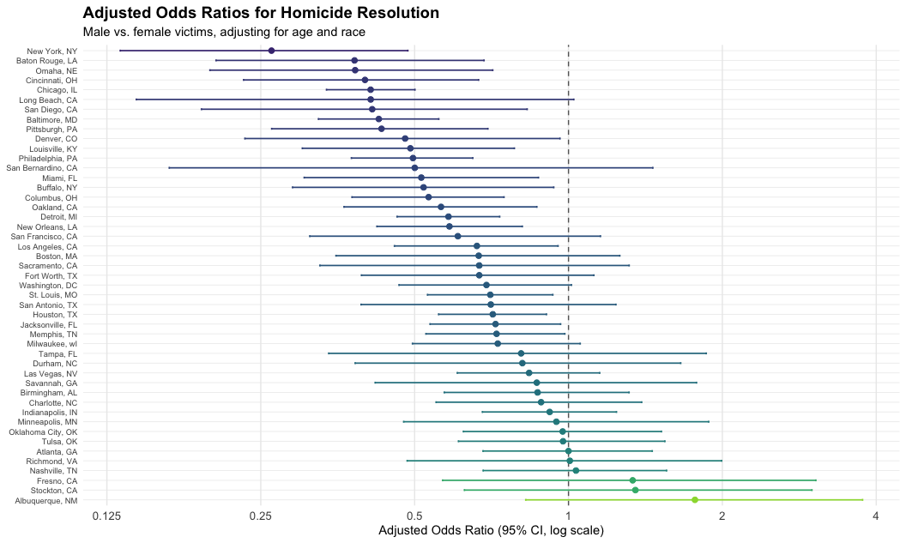
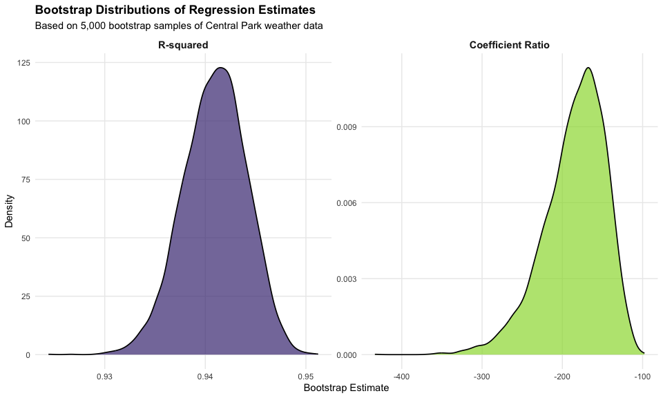

P8105 Homework 6
================
Lina Marcinczyk
2026-11-25

## Problem 1: U.S. Homicides

Import and clean

``` r
homicide_df = 
  read_csv("data/homicide-data.csv", 
           na = c("", "NA", "Unknown")) |> 
  mutate(
    city_state = str_c(city, state, sep = ", "),
    resolved = as.numeric(disposition == "Closed by arrest"),
    victim_age = as.numeric(victim_age)
  ) |> 
  filter(
    !city_state %in% c(
      "Dallas, TX",
      "Phoenix, AZ",
      "Kansas City, MO",
      "Tulsa, AL"
    ),
    victim_race %in% c("White", "Black")
  ) |> 
  mutate(
    victim_race = fct_relevel(victim_race, "White"),
    victim_sex = fct_relevel(victim_sex, "Female")
  )
```

#### Baltimore Logistic Regression

``` r
baltimore_glm = 
  homicide_df |> 
  filter(city_state == "Baltimore, MD") |> 
  glm(
    resolved ~ victim_age + victim_sex + victim_race,
    data = _,
    family = binomial()
  )

baltimore_results = 
  baltimore_glm |> 
  broom::tidy(conf.int = TRUE, exponentiate = TRUE) |> 
  filter(term == "victim_sexMale") |> 
  select(term, estimate, conf.low, conf.high)

baltimore_results |> 
  mutate(term = "Male vs. Female") |> 
  knitr::kable(
    digits = 3,
    col.names = c(
      "Comparison", "Adjusted OR", 
      "Lower 95% CI", "Upper 95% CI"
    ),
    caption = "**Table 1:** Adjusted odds ratio for homicide resolution in Baltimore, MD"
  )
```

| Comparison      | Adjusted OR | Lower 95% CI | Upper 95% CI |
|:----------------|------------:|-------------:|-------------:|
| Male vs. Female |       0.426 |        0.324 |        0.558 |

**Table 1:** Adjusted odds ratio for homicide resolution in Baltimore,
MD

In Baltimore, the adjusted odds ratio for solving homicides comparing
male victims to female victims is 0.426 (95% CI: 0.324–0.558). Holding
victim age and race constant, the odds of solving a homicide involving a
male victim are approximately 57.4% lower than those involving a female
victim. Since the 95% confidence interval does not contain 1, this
association is statistically significant at the 0.05 level.

#### Logistic Regression for All Cities

``` r
city_results_df = 
  homicide_df |> 
  nest(data = -city_state) |> 
  mutate(
    models = map(
      data, 
      \(df) glm(
        resolved ~ victim_age + victim_sex + victim_race,
        data = df,
        family = binomial()
      )
    ),
    results = map(
      models,
      \(model) broom::tidy(
        model,
        conf.int = TRUE,
        exponentiate = TRUE
      )
    )
  ) |> 
  select(city_state, results) |> 
  unnest(results) |> 
  filter(term == "victim_sexMale") |> 
  select(city_state, estimate, conf.low, conf.high)
```

#### Plot for all Cities

``` r
city_results_df |> 
  mutate(
    city_state = fct_reorder(city_state, estimate, .desc = TRUE)
  ) |> 
  ggplot(aes(x = estimate, y = city_state, color = estimate)) +
  geom_vline(
    xintercept = 1,
    linetype = "dashed",
    color = "gray40"
  ) +
  geom_errorbar(
    aes(xmin = conf.low, xmax = conf.high),
    width = 0.2,
    linewidth = 0.6
  ) +
  geom_point(size = 2) +
  scale_x_log10(
    breaks = c(0.125, 0.25, 0.5, 1, 2, 4),
    labels = c("0.125", "0.25", "0.5", "1", "2", "4")
  ) +
  scale_color_viridis_c(begin = 0.15, end = 0.85) +
  labs(
    title = "Adjusted Odds Ratios for Homicide Resolution",
    subtitle = "Male vs. female victims, adjusting for age and race",
    x = "Adjusted Odds Ratio (95% CI, log scale)",
    y = NULL
  ) +
  theme_minimal(base_size = 11) +
  theme(
    legend.position = "none",
    axis.text.y = element_text(size = 7),
    axis.text.x = element_text(size = 10),
    panel.grid.minor = element_blank(),
    panel.grid.major.y = element_line(
      color = "gray93", linewidth = 0.3
    ),
    plot.title = element_text(face = "bold", size = 14),
    plot.subtitle = element_text(size = 11)
  )
```



Across the 47 cities, 41 have estimated adjusted odds ratios below 1,
suggesting that homicides involving male victims generally have lower
odds of being solved than those involving female victims, after
adjusting for victim age and race.

New York, NY has the lowest estimated odds ratio (0.262), while
Albuquerque, NM has the highest (1.767).

For 22 cities, the 95% confidence interval lies entirely below 1,
indicating a statistically significant association at the 0.05 level.
However, many cities have confidence intervals that include 1,
suggesting insufficient evidence of a difference in homicide resolution
odds between male and female victims.

The widths of the confidence intervals vary considerably across cities,
reflecting differences in the precision of the estimated odds ratios.

## Problem 2: Central Park Weather

Clean

``` r
weather_clean_df = 
  weather_df |> 
  select(tmax, tmin, prcp) |> 
  drop_na()
```

#### Fit the Regression Model

``` r
weather_lm = 
  lm(tmax ~ tmin + prcp, data = weather_clean_df)

weather_lm |> 
  broom::tidy() |> 
  mutate(
    term = recode(
      term,
      "(Intercept)" = "Intercept",
      "tmin" = "Minimum temperature",
      "prcp" = "Precipitation"
    ),
    p.value = format.pval(p.value, digits = 3, eps = 0.001)
  ) |> 
  knitr::kable(
    digits = 4,
    col.names = c(
      "Predictor", "Estimate", "Standard Error",
      "t-statistic", "p-value"
    ),
    caption = "**Table 2:** Linear regression estimates for maximum daily temperature"
  )
```

| Predictor           | Estimate | Standard Error | t-statistic | p-value |
|:--------------------|---------:|---------------:|------------:|:--------|
| Intercept           |   7.7756 |         0.0854 |     91.0432 | \<0.001 |
| Minimum temperature |   1.0175 |         0.0056 |    182.2986 | \<0.001 |
| Precipitation       |  -0.0056 |         0.0006 |     -9.4112 | \<0.001 |

**Table 2:** Linear regression estimates for maximum daily temperature

Minimum temperature is positively associated with maximum daily
temperature, while precipitation is negatively associated with maximum
daily temperature, holding the other predictor constant. Both
associations are statistically significant ($p < 0.001$). The model
explains approximately 94.1% of the observed variation in maximum daily
temperature. This fitted model serves as the basis for the subsequent
bootstrap analysis.

#### Bootstrapping 5000 samples

``` r
weather_bootstrap_df = 
  weather_clean_df |> 
  modelr::bootstrap(n = 5000) |> 
  mutate(
    models = map(
      strap,
      \(df) lm(tmax ~ tmin + prcp, data = df)
    ),
    glance_results = map(models, broom::glance),
    tidy_results = map(models, broom::tidy)
  )
```

##### Extracting $R^2$

``` r
bootstrap_r2_df = 
  weather_bootstrap_df |> 
  select(.id, glance_results) |> 
  unnest(glance_results) |> 
  select(.id, r.squared)
```

##### Coefficient Ratio

``` r
bootstrap_ratio_df = 
  weather_bootstrap_df |> 
  select(.id, tidy_results) |> 
  unnest(tidy_results) |> 
  filter(term %in% c("tmin", "prcp")) |> 
  select(.id, term, estimate) |> 
  pivot_wider(
    names_from = term,
    values_from = estimate
  ) |> 
  mutate(beta_ratio = tmin / prcp) |> 
  select(.id, beta_ratio)
```

``` r
bootstrap_results_df = 
  bootstrap_r2_df |> 
  left_join(bootstrap_ratio_df, by = ".id")
```

#### Plotting the bootstrap distributions

``` r
bootstrap_results_df |> 
  select(r.squared, beta_ratio) |> 
  pivot_longer(
    everything(),
    names_to = "quantity",
    values_to = "estimate"
  ) |> 
  mutate(
    quantity = recode(
      quantity,
      r.squared = "R-squared",
      beta_ratio = "Coefficient Ratio"
    ),
    quantity = factor(
      quantity,
      levels = c("R-squared", "Coefficient Ratio")
    )
  ) |> 
  ggplot(aes(x = estimate, fill = quantity)) +
  geom_density(alpha = 0.7, linewidth = 0.6) +
  facet_wrap(~quantity, scales = "free") +
  scale_fill_viridis_d(begin = 0.15, end = 0.85) +
  labs(
    title = "Bootstrap Distributions of Regression Estimates",
    subtitle = "Based on 5,000 bootstrap samples of Central Park weather data",
    x = "Bootstrap Estimate",
    y = "Density"
  ) +
  theme_minimal() +
  theme(
    legend.position = "none",
    plot.title = element_text(face = "bold"),
    strip.text = element_text(face = "bold", size = 11),
    panel.grid.minor = element_blank()
  )
```



The bootstrap distribution of $r^2$ is approximately bell-shaped with
slight left skewness, centered around 0.941 with a standard deviation of
0.0032. The narrow distribution suggests that the estimated proportion
of variation in maximum temperature explained by the model is relatively
stable across bootstrap samples.

In contrast, the bootstrap distribution of
$\hat{\beta}_1 / \hat{\beta}_2$ is noticeably left-skewed, with a longer
tail toward more negative values. The distribution has a mean of -185.02
and a standard deviation of 38.55. This asymmetry supports the use of
bootstrap percentile confidence intervals rather than relying on a
normal approximation.

#### Confidenece Intervals

``` r
bootstrap_ci_df = 
  bootstrap_results_df |> 
  select(r.squared, beta_ratio) |> 
  pivot_longer(
    everything(),
    names_to = "quantity",
    values_to = "estimate"
  ) |> 
  group_by(quantity) |> 
  summarize(
    lower_ci = quantile(estimate, 0.025),
    upper_ci = quantile(estimate, 0.975)
  ) |> 
  ungroup()

bootstrap_ci_df |> 
  mutate(
    quantity = recode(
      quantity,
      r.squared = "R-squared",
      beta_ratio = "Coefficient Ratio"
    )
  ) |> 
  knitr::kable(
    digits = 4,
    col.names = c(
      "Quantity", "Lower 95% CI", "Upper 95% CI"
    ),
    caption = "95% percentile confidence intervals based on 5,000 bootstrap samples"
  )
```

| Quantity          | Lower 95% CI | Upper 95% CI |
|:------------------|-------------:|-------------:|
| Coefficient Ratio |    -274.7945 |    -125.4836 |
| R-squared         |       0.9345 |       0.9467 |

95% percentile confidence intervals based on 5,000 bootstrap samples

The 95% bootstrap percentile confidence interval for $r^2$ is (0.9345,
0.9467). This narrow interval suggests that the model consistently
explains a high proportion of the variation in maximum daily
temperature.

The 95% bootstrap percentile confidence interval for
$\hat{\beta}_1 / \hat{\beta}_2$ is (-274.79, -125.48). The interval is
entirely negative, consistent with the positive estimated coefficient
for minimum temperature and the negative estimated coefficient for
precipitation. The asymmetry of the bootstrap distribution illustrates
the usefulness of the percentile bootstrap method for inference on
nonlinear functions of regression coefficients.
